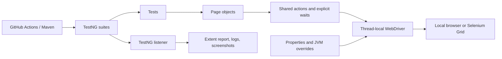

# Selenium Test Automation

[](https://github.com/vinjavarapu/SeleniumTestAutomation/actions/workflows/selenium-tests.yml)

A Java, Selenium WebDriver, and TestNG sample framework for browser-based testing of the public SauceDemo practice application. It demonstrates page objects, configuration, isolated browser sessions, parallel execution, failure artifacts, and CI execution. It is a portfolio/sample project, not a claim of production validation against a client application.

## What it includes

- Page objects and shared Selenium actions with explicit waits
- Typed configuration with defaults, QA/staging overrides, and JVM-property precedence
- Local Chrome, Firefox, and Edge drivers, plus remote Selenium Grid support
- Thread-local WebDriver lifecycle for parallel TestNG methods
- ExtentReports, structured logs, and failure screenshots
- Separate framework-configuration unit tests and browser smoke/regression suites
- GitHub Actions coverage for Chrome/Firefox smoke tests and Chrome regression runs

## Architecture



## Repository layout

```text
src/test/java/io/github/vinjavarapu/seleniumtestautomation/framework/
  base/          Browser lifecycle and shared page actions
  config/        Configuration loading and validation
  driver/        Local/remote driver factory and thread-local storage
  listeners/     Test lifecycle, reporting, and optional retries
  pages/         SauceDemo page objects
  reporting/     Test-step reporting bridge
  unittests/     Fast framework unit tests
  utils/         Wait, test-data, and ExtentReports helpers
  tests/         Smoke and regression browser tests
src/test/resources/
  config/        QA and staging overrides
  suites/        Unit, smoke, regression, and all-test suites
  testdata/      Public SauceDemo fixture values
.github/workflows/selenium-tests.yml
```

## Run locally

Requires JDK 25 and Maven.

```powershell
# Fast, browser-free framework checks
mvn --batch-mode test -Punit

# Browser smoke tests
mvn --batch-mode test -Psmoke

# Full browser regression suite
mvn --batch-mode test -Pregression
```

The browser suites use headless mode by default. Override settings with Maven system properties:

```powershell
mvn --batch-mode test -Psmoke -Denv=qa -Dbrowser=chrome -Dheadless=true
mvn --batch-mode test -Pregression -DremoteUrl=http://localhost:4444 -Dbrowser=chrome
```

The supported browser values are `chrome`, `firefox`, and `edge`. Before starting a browser, the framework validates the application URL, browser, wait timeout, retry count, headless setting, and optional Grid URL. Environment values can be overridden with JVM properties such as `-DbaseUrl=https://test.example.com`.

Configuration precedence (highest first): JVM system property, `config/{env}.properties`, then `config.properties`. The default environment is `qa`. Use runtime environment variables such as `TESTDATA_VALID_USERNAME` and `TESTDATA_VALID_PASSWORD` for private test data; do not put private credentials in the repository. Checked-in SauceDemo fixture values are public demo data.

## CI and artifacts

GitHub Actions runs the unit suite and browser suites on pull requests, pushes to `main`, manual dispatches, and the nightly schedule. Chrome/Firefox smoke and Chrome regression runs use QA by default. Setting the repository variable `STAGING_BASE_URL` adds staging runs; `CHROME_VERSION` can pin the Chrome for Testing version. CI retries are disabled so a first-attempt failure remains visible.

Run artifacts include Surefire XML, Extent HTML reports, logs, and failure screenshots under `target/`. CI uploads browser-run artifacts for 30 days.

## Scope and extension

The checked-in browser tests target SauceDemo and its shared public demo account. For client adoption, configure an authorized test environment and test data, set parallelism to match that environment's capacity, and add application-specific API/data setup and teardown where supported. The framework does not yet include measured reliability/performance baselines, a reusable published Maven module, or client-system validation.

The test catalogue is in [`SauceDemo_Selenium_Java_Test_Cases.pdf`](SauceDemo_Selenium_Java_Test_Cases.pdf); architectural notes are in [`OnlineHelp/`](OnlineHelp/).
