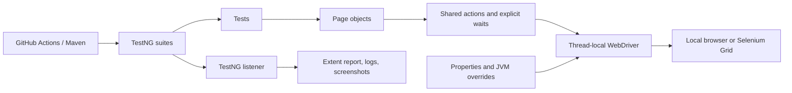

# Selenium Test Automation

[](https://github.com/vinjavarapu/SeleniumTestAutomation/actions/workflows/selenium-tests.yml)

A Java, Selenium WebDriver, and TestNG sample framework for browser-based testing of the public SauceDemo practice application. It demonstrates page objects, configuration, isolated browser sessions, parallel execution, failure artifacts, and CI execution. It is a portfolio/sample project, not a claim of production validation against a client application.

## What it includes

- Page objects and shared Selenium actions with explicit waits
- Typed configuration with defaults, QA/staging overrides, and JVM-property precedence
- Local Chrome, Firefox, and Edge drivers, plus remote Selenium Grid support
- Thread-local WebDriver lifecycle for parallel TestNG methods
- ExtentReports, structured logs, and failure screenshots
- Separate framework-configuration unit tests and browser smoke/regression suites
- GitHub Actions coverage for Chrome/Firefox smoke tests and Chrome regression runs

## Architecture



## Repository layout

```text
src/test/java/io/github/vinjavarapu/seleniumtestautomation/framework/
  base/          Browser lifecycle and shared page actions
  config/        Configuration loading and validation
  driver/        Local/remote driver factory and thread-local storage
  listeners/     Test lifecycle, reporting, and optional retries
  pages/         SauceDemo page objects
  reporting/     Test-step reporting bridge
  unittests/     Fast framework unit tests
  utils/         Wait, test-data, and ExtentReports helpers
  tests/         Smoke and regression browser tests
src/test/resources/
  config/        QA and staging overrides
  suites/        Unit, smoke, regression, and all-test suites
  testdata/      Public SauceDemo fixture values
.github/workflows/selenium-tests.yml
```

## Run locally

Requires JDK 25 and Maven.

```powershell
# Fast, browser-free framework checks
mvn --batch-mode test -Punit

# Browser smoke tests
mvn --batch-mode test -Psmoke

# Full browser regression suite
mvn --batch-mode test -Pregression
```

The browser suites use headless mode by default. Override settings with Maven system properties:

```powershell
mvn --batch-mode test -Psmoke -Denv=qa -Dbrowser=chrome -Dheadless=true
mvn --batch-mode test -Pregression -DremoteUrl=http://localhost:4444 -Dbrowser=chrome
```

The supported browser values are `chrome`, `firefox`, and `edge`. Before starting a browser, the framework validates the application URL, browser, wait timeout, retry count, headless setting, and optional Grid URL. Environment values can be overridden with JVM properties such as `-DbaseUrl=https://test.example.com`.

### Ubuntu / GCP VM setup

For local Chrome runs on an Ubuntu VM, install Google Chrome Stable instead of Ubuntu's Snap Chromium package. The Snap launcher can fail to start reliably under ChromeDriver. From the repository root, run:

```bash
sudo bash scripts/setup-ubuntu-chrome.sh
google-chrome --version
mvn --batch-mode clean test -Psmoke -Denv=qa -Dbrowser=chrome -Dheadless=true
```

WebDriverManager downloads the ChromeDriver needed by the installed Chrome version. The VM needs outbound access to Google's apt repository and the driver download source. If the VM is behind a restricted network, use the project's remote Selenium Grid option instead.

Configuration precedence (highest first): JVM system property, framework environment variable, `config/{env}.properties`, then `config.properties`. The default environment is `qa`. Supported framework environment variables include `BASE_URL`, `BROWSER`, `HEADLESS`, `EXPLICIT_WAIT_SECONDS`, `RETRY_COUNT`, `REMOTE_URL`, and `REPORT_NAME`. Use runtime environment variables such as `TESTDATA_VALID_USERNAME` and `TESTDATA_VALID_PASSWORD` for private test data; do not put private credentials in the repository. Checked-in SauceDemo fixture values are public demo data.

QA and staging intentionally use the same public SauceDemo sandbox URL. A CI staging run can override that URL through the `STAGING_BASE_URL` repository variable, or a local staging run can use `-DbaseUrl=https://your-sandbox.example.test`.

## CI and artifacts

GitHub Actions runs the unit suite and browser suites on pull requests, pushes to `main`, manual dispatches, and the nightly schedule. Chrome/Firefox smoke and Chrome regression runs use QA by default. Setting the repository variable `STAGING_BASE_URL` adds staging runs; `CHROME_VERSION` can pin the Chrome for Testing version. CI retries are disabled so a first-attempt failure remains visible.

Run artifacts include Surefire XML, Extent HTML reports, logs, and failure screenshots under `target/`. CI uploads browser-run artifacts for 30 days.

## Dependency security scanning

The [OWASP Dependency-Check Maven plugin](https://dependency-check.github.io/DependencyCheck/dependency-check-maven/) analyzes direct and transitive Maven dependencies against known vulnerability data, including CVE identifiers and CVSS severity. This project scans test-scoped dependencies too because Selenium and the framework libraries are test dependencies. Dependency-Check does not prove that the project is vulnerability-free; findings require review and remediation.

The scan is isolated in the `security` Maven profile and does not run as part of unit, smoke, regression, or default `all` test commands. It skips test compilation and execution, keeps vulnerability findings report-only initially, and still fails if the analysis itself cannot complete.

Requires the project prerequisites above (JDK 25 and Maven 3.8.1 or later). Run the scan from the repository root:

```powershell
mvn --batch-mode --no-transfer-progress -Psecurity verify -DskipTests
```

The scan uses Dependency-Check Maven 12.2.2. Although 13.0.0 is the latest published release, its keyless NVD update path is broken ([upstream issue #8715](https://github.com/dependency-check/DependencyCheck/issues/8715)); the fix is assigned to 13.0.1, which is not yet published. Version 12.2.2 is used so an initial scan can work without a key. Reassess the plugin version when the upstream fix is released. The first scan downloads and initializes the vulnerability database and can take 20 minutes or longer. Later scans reuse the local Dependency-Check database and update it automatically; do not disable those updates. The optional .NET assembly analyzer is disabled because this project scans Java/Maven dependencies. Reports are written to `target/security-dependency-check/`:

- `dependency-check-report.html` — human-readable findings and remediation details.
- `dependency-check-report.json` — machine-readable dependency, CVE, CVSS, and vulnerability data.

### Optional NVD API key

An API key improves NVD request rate limits but is optional. Without one, the scan is still attempted and may take longer or be rate-limited. Request a key from the [NVD API key page](https://nvd.nist.gov/developers/request-an-api-key). Set it only in your local shell or secret manager; do not put it in the POM, source control, or command-line arguments.

PowerShell for the current session:

```powershell
$env:NVD_API_KEY = "your-nvd-api-key"
if ([string]::IsNullOrWhiteSpace($env:NVD_API_KEY)) {
    mvn --batch-mode --no-transfer-progress -Psecurity verify -DskipTests
} else {
    mvn --batch-mode --no-transfer-progress -Psecurity verify -DskipTests -DnvdApiKeyEnvironmentVariable=NVD_API_KEY
}
```

When the key is present, Maven receives only the environment-variable name, not the secret value; the plugin reads the value directly from the process environment. In GitHub, optionally add a repository or organization Actions secret named `NVD_API_KEY`; the independent [`Dependency security scan` workflow](.github/workflows/dependency-check.yml) passes it through the job environment and only enables the plugin setting when the secret is non-empty. That workflow runs on a weekly schedule, manually, and when the POM or scan workflow changes. It caches the local vulnerability database and uploads reports for 30 days. Pull requests from forks will not receive repository secrets, so those scans proceed without the key.

### Reviewing and handling findings

Dependency-Check reports severity using CVSS. Use Critical 9.0–10.0, High 7.0–8.9, Medium 4.0–6.9, and Low 0.1–3.9 as triage bands; inspect the CVE details, affected dependency version, and fixed versions in the report before deciding on an update. Update the direct dependency or the dependency that brings in a vulnerable transitive component, then rerun the scan and relevant tests.

The initial policy does not fail the build for CVE findings so the existing dependency baseline can be reviewed first. Once findings are triaged and high-impact issues addressed, consider gating Critical findings at CVSS 9.0, then High findings at 7.0. Do not add blanket suppressions to make a scan pass. For a confirmed false positive, document the CVE, affected component, technical rationale, owner, and review/expiry date in a narrowly scoped suppression rule, and periodically revalidate it.

## Scope and extension

The checked-in browser tests target SauceDemo and its shared public demo account. For client adoption, configure an authorized test environment and test data, set parallelism to match that environment's capacity, and add application-specific API/data setup and teardown where supported. The framework does not yet include measured reliability/performance baselines, a reusable published Maven module, or client-system validation.

The test catalogue is in [`SauceDemo_Selenium_Java_Test_Cases.pdf`](SauceDemo_Selenium_Java_Test_Cases.pdf); architectural notes are in [`OnlineHelp/`](OnlineHelp/).
